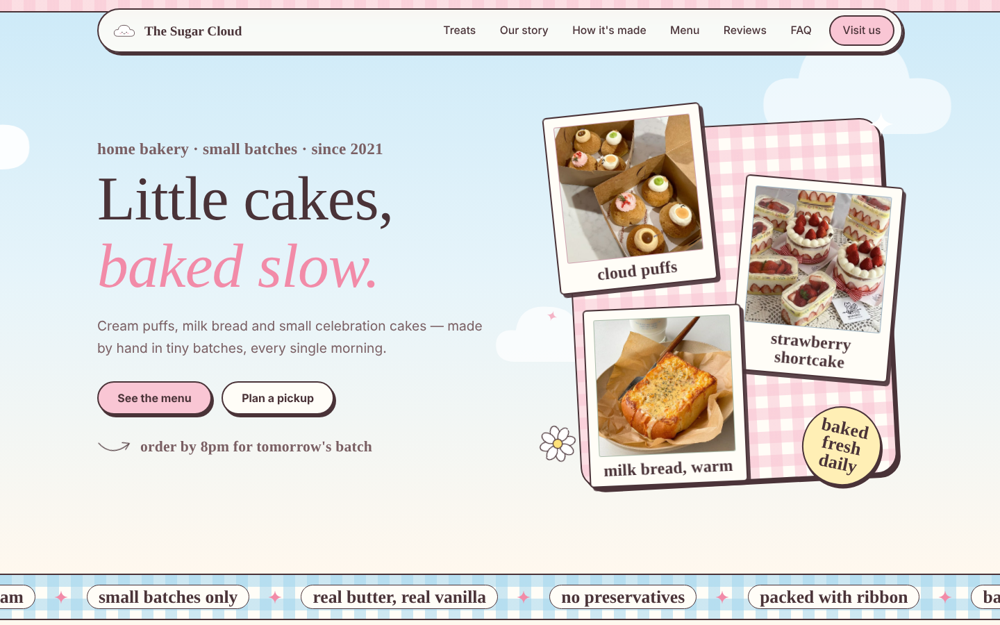
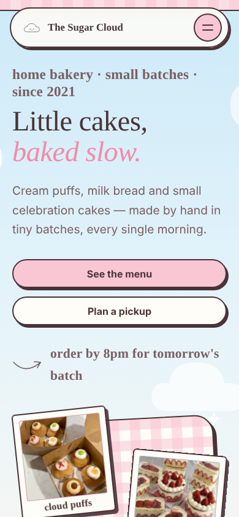

# The Sugar Cloud — Landing Page

**Oasis Infobyte SIP · Web Development & Designing · Level 1 · Task 1**

A responsive landing page for **The Sugar Cloud**, a fictional home bakery and dessert studio. The look mixes a Korean-bakery pastel palette with a soft Ghibli sky, gingham prints and a scrapbook feel (polaroids, washi tape, handwritten notes). The page uses real photos, with hand-drawn SVG illustrations as a fallback for any photo that is missing.

## Tech stack
HTML5 and CSS3 (Flexbox + Grid). A small `script.js` adds the loader, custom cursor, tilt and scroll-reveal effects. **The page works fully without JavaScript** — these are enhancements only.

## Feature checklist (from the task card)
- [x] Sticky navigation bar with 6 links plus a "Visit us" button
- [x] Hero with headline, subheadline and call-to-action buttons
- [x] Content sections: Featured treats, Our story, How it's made, Menu, Testimonials, FAQ and Visit us (more than the 2 required)
- [x] Footer with placeholder contact and social links
- [x] Consistent palette, set as CSS variables in `:root`
- [x] Responsive layout with Flexbox and Grid (checked at 390px, 768px and 1440px)
- [x] Intentional spacing: `box-sizing: border-box` everywhere, deliberate scrapbook overlaps only
- [x] Typography with a clear heading vs body scale (Fraunces, DM Sans, Gaegu)

## Extra details
- Loading intro animation ("preheating the oven…")
- Custom heart cursor that leaves a sparkly trail (desktop only; click for a burst of sparkles)
- Hover effects: 3D image tilt, wavy underline draw, colour swap on cards, buttons and notes
- Scroll-reveal animations (`IntersectionObserver`)
- Active-section highlight in the nav
- Accessible FAQ built with native `
`
- Respects `prefers-reduced-motion`

## Photos
The 9 photos live in `images/` (hero collage, product cards and the story section). To swap one, replace the file and keep the same filename. See [`images/PHOTO-LIST.md`](images/PHOTO-LIST.md) for what each file is. A missing file falls back to its illustration automatically.

## Live site
https://aryasharmacs006-cyber.github.io/OIBSIP/WebDev-L1-LandingPage/

## Run
Open `index.html` in any browser, or use the live link above.

## Notes
The Sugar Cloud, its menu, prices and testimonials are fictional and were made up for this internship project. Photos are reference images chosen by the author; swap in your own or credit the original photographers before using this site commercially.

## Screenshots

