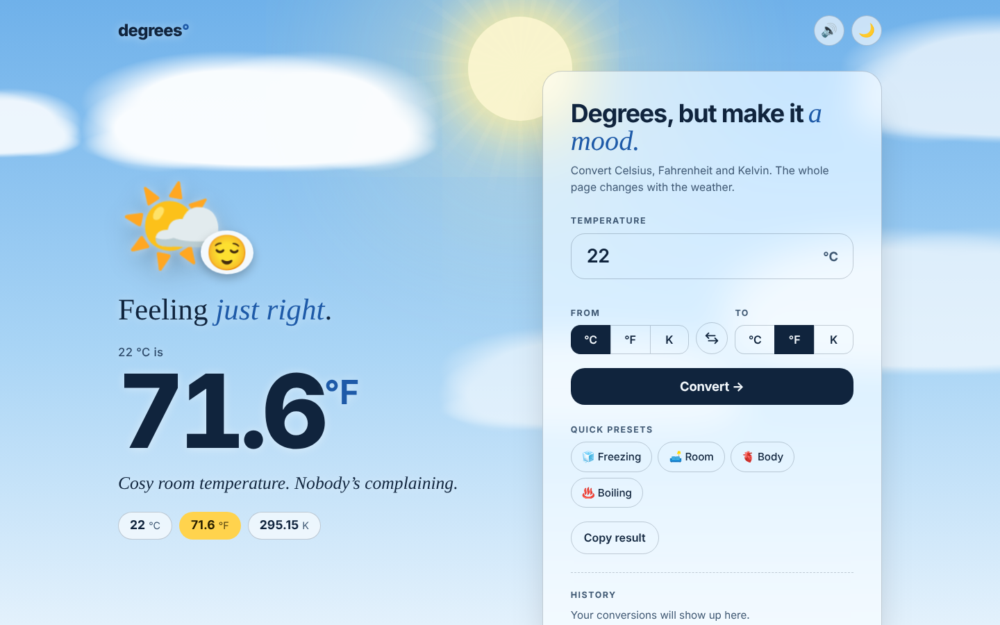
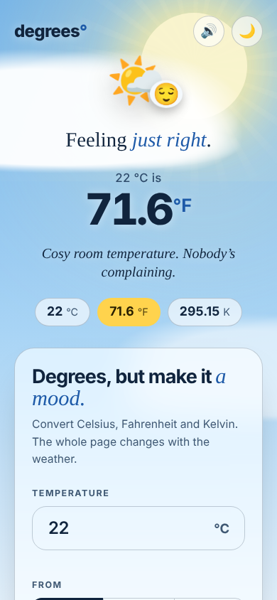

# Degrees — Temperature Converter

**Oasis Infobyte SIP · Web Development & Designing · Level 1 · Task 3**

An interactive temperature converter for **Celsius, Fahrenheit and Kelvin**. The whole page changes with the weather, like a weather app: a realistic sky behind the converter shifts from a snowy night to a cloudy day, a bright yellow sunny sky, a blazing orange heatwave and a molten red scene, with real falling snow, drifting clouds, a glowing sun, pollen and rising embers. The weather emoji, mood face and a one-line fun fact change too.

## Tech stack
HTML5, CSS3, vanilla JavaScript. No libraries.

## Feature checklist (from the task card)
- [x] Numeric input with validation. Non-numeric input is rejected with a friendly message.
- [x] Input unit selector (°C / °F / K)
- [x] Output unit selector, plus **all three units shown at once** in the result chips
- [x] **Convert** button triggers the calculation (Enter works too)
- [x] Result display with correct unit labels
- [x] Absolute-zero handling: values below −273.15 °C (−459.67 °F, 0 K) show a funny, helpful error
- [x] Clean, centred layout with clear labels

## Extras
- Swap-units button (chains the result into the input)
- Quick presets: freezing, room, body temperature, boiling
- Copy-result button
- Conversion history (last 8, saved in `localStorage`, click to reuse, clearable)
- A fun fact for every result
- Count-up number animation
- Click sound on convert (synthesised with the Web Audio API, with a mute toggle)
- Dark mode: the same scenes at night, with stars and a moon (follows system preference, with a toggle)
- Live weather background (sky colours, sun, clouds, snowfall canvas, embers) that changes with the temperature
- Weather and mood emojis that change with the temperature
- Accessible: labelled controls, `aria-live` results, keyboard support, `prefers-reduced-motion`

## Formulas
- °F = °C × 9/5 + 32
- °C = (°F − 32) × 5/9
- K = °C + 273.15

## Weather scenes (by Celsius)
| Range | Scene | Mood |
|---|---|---|
| below 0 | Snowy night, heavy snowfall (heavier the colder it gets) | Frozen solid 🥶 |
| 0 to 14 | Overcast sky with drifting clouds, light flurries below 5 | Cosy 😶‍🌫️ |
| 15 to 25 | Clear blue sky, soft sun and white clouds | Just right 😌 |
| 26 to 34 | Bright yellow sunny sky, big sun with rays | Sunny 😎 |
| 35 to 99 | Orange heatwave sky, huge sun, golden heat-haze dust | Sizzling 🥵 |
| 100 and up | Fiery red sky, glowing horizon, rising embers | Molten 🫠 |

## Live site
https://aryasharmacs006-cyber.github.io/OIBSIP/WebDev-L1-TemperatureConverter/

## Run
Open `index.html` in any browser, or use the live link above.

## Screenshots

